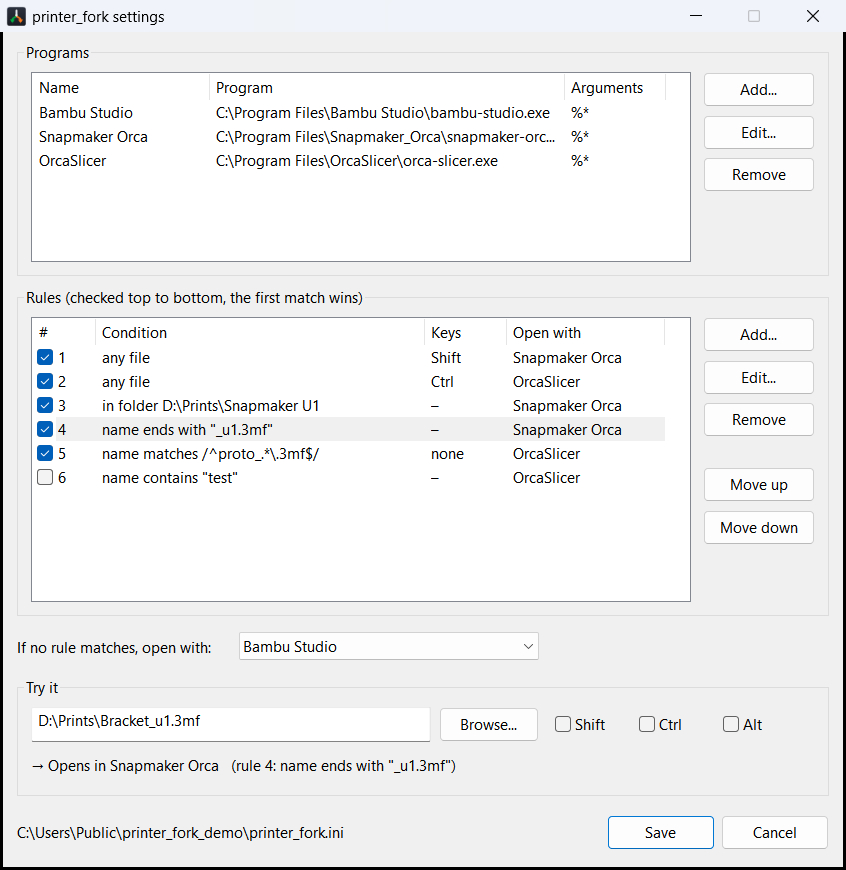
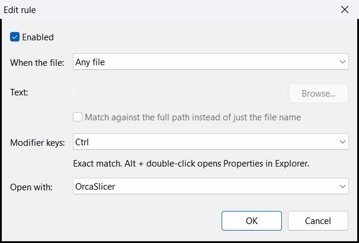

# printer_fork


Tiny Windows launcher: set it as the default app for a file type (e.g. `.3mf`) and it opens each file in the right program, picked by rules you define. It's native C++ with no console window, and it exits as soon as the program has started.

## Download

Grab `printer_fork.exe` from the [latest release](../../releases/latest). Put it somewhere permanent, then choose it in Windows' *Open with → Choose another app* for `.3mf` files.

## Rules

Run `printer_fork.exe` **without a file** (or with `--settings`) to open the settings window:



- **Programs**: any number of slicers or other apps, each with a path and arguments
  (`%*` = arguments exactly as received, `"%f"` = the opened file).
- **Rules** are checked top to bottom, and the **first match wins**. Reorder them with *Move up / Move down*, and use the checkbox to turn a rule off. Each rule has:
  - a condition on the file: **ends with**, **starts with**, **contains**, **matches regex**, **is in folder (incl. subfolders)**, or **any file**. Text matching ignores case and checks the file name, or the full path if you tick that option.
  - a **modifier keys** condition: *doesn't matter*, *none held*, or an exact combination of **Shift / Ctrl / Alt** (e.g. Ctrl → one slicer, Ctrl+Shift → another, no modifier → a third). The match is exact, so a *Shift* rule doesn't fire when Ctrl+Shift is held. Note that Alt + double-click (or Alt+Enter) opens *Properties* in Explorer, so Shift and Ctrl are the practical choices there.
  - the program to open matching files with.

  

- **If no rule matches**: the default program.
- **Try it**: type or browse to a path and tick Shift / Ctrl / Alt to see which rule would fire.

The default setup matches the original behaviour:

1. Any file with Shift (alone) held → Snapmaker Orca
2. Name ends with `_u1.3mf` → Snapmaker Orca
3. Otherwise → Bambu Studio

Settings are saved to `printer_fork.ini` next to the exe. If that folder isn't writable, they go to `%APPDATA%\printer_fork\printer_fork.ini` instead. The file is plain text and safe to edit by hand.

## Build

Locally with MinGW-w64 (`g++` and `windres` on PATH):

```
build.cmd
```

`make_icon.ps1` regenerates `printer_fork.ico` / `printer_fork.png`.

## CI and releases

- **Build** runs on every push and pull request and uploads `printer_fork.exe` as a workflow artifact.
- **Release** builds the exe and publishes a GitHub release with it attached. Start it from *Actions → Release → Run workflow* and enter a version such as `v1.2.0`, or push a tag:

  ```
  git tag v1.2.0
  git push origin v1.2.0
  ```
